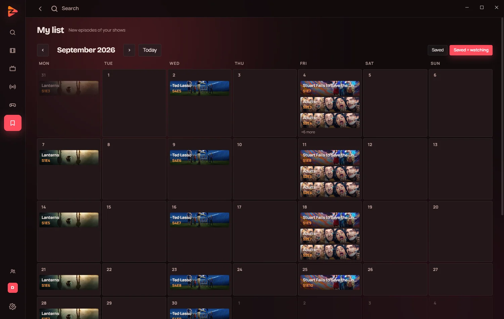

<h3>Films, shows and live channels — on your PC, your phone and your TV.</h3>

 

Install once — it keeps itself up to date.

 

<table>
<tr>
<td width="50%"></td>
<td width="50%"></td>
</tr>
</table>

 

## Highlights

<table>
<tr>
<td width="33%" valign="top"><b>🗂️ Every catalogue, one home</b> A row for each catalogue, genres to browse, and one search across all of them.</td>
<td width="33%" valign="top"><b>🔄 Picks up where you left off</b> Sign in once: your list, history and place in every episode follow you to each screen.</td>
<td width="33%" valign="top"><b>📅 Never miss an episode</b> My list shows what's new from your shows on a calendar.</td>
</tr>
<tr>
<td valign="top"><b>📺 Live channels</b> Always-on channels built from the catalogue — something's on when you sit down.</td>
<td valign="top"><b>⏭️ Skips the credits</b> Finds where the credits start and moves on to the next episode.</td>
<td valign="top"><b>🎧 Plays it properly</b> HDR, surround sound passed to your receiver, and every subtitle format.</td>
</tr>
</table>

## Addons

stream-thing is built on the open [Stremio addon protocol](https://github.com/Stremio/stremio-addon-sdk/blob/master/docs/protocol.md). It's ready to browse from the start, with addons for catalogues, details and subtitles already installed.

Want more? Add any compatible addon — more catalogues, more subtitle languages, other sources:

- paste the addon's link **anywhere** in the app and it offers to install it, or
- go to **Settings → Addons**.

Your addons are saved to your account, so adding one on your PC adds it on your phone and TV too.

## Getting started

| | |
|---|---|
| **1. Install** | **Windows** — run the installer · **Android** — open the file and allow the install · **Android TV** — in the *Downloader* app, go to `ziggygamedev.github.io/stream-thing-releases/tv` · **Samsung** — in *TizenBrew*, add the module `ZiggyGameDev/stream-thing-releases` · **LG** — install in Developer Mode |
| **2. Sign in** | With Google. On a TV, sign in from your phone with the code on screen. |
| **3. Watch** | Pick something and press play. |

Need a hand? The **[website](https://ziggygamedev.github.io/stream-thing-releases/)** walks through each step with pictures.

 

<a href="https://ziggygamedev.github.io/stream-thing-releases/">Website</a> ·
<a href="https://github.com/ZiggyGameDev/stream-thing-releases/releases">All releases</a> ·
Not affiliated with Stremio

Maintainers

 

- Releases are made by `.github/workflows/release.yml` from a pushed `upload/v<version>` branch, after every file is checked against `latest.json`. Nothing is built here.
- `stream-thing-windows.exe` stays in every release under that name: installed copies on Windows update from it.
- `samsung/` is the unpacked Samsung build for TizenBrew, written by the workflow. Don't edit it by hand.
- The site is the top-level files, served by GitHub Pages from `main`. No build step.

