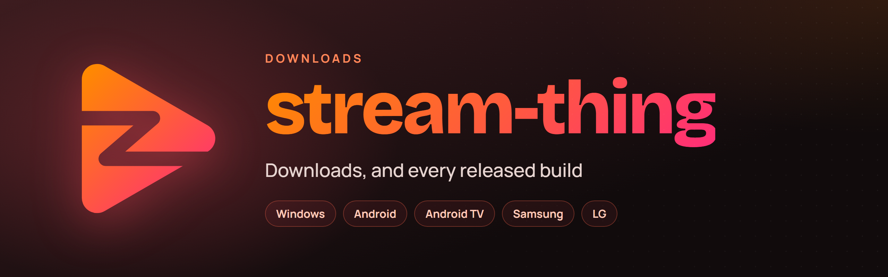
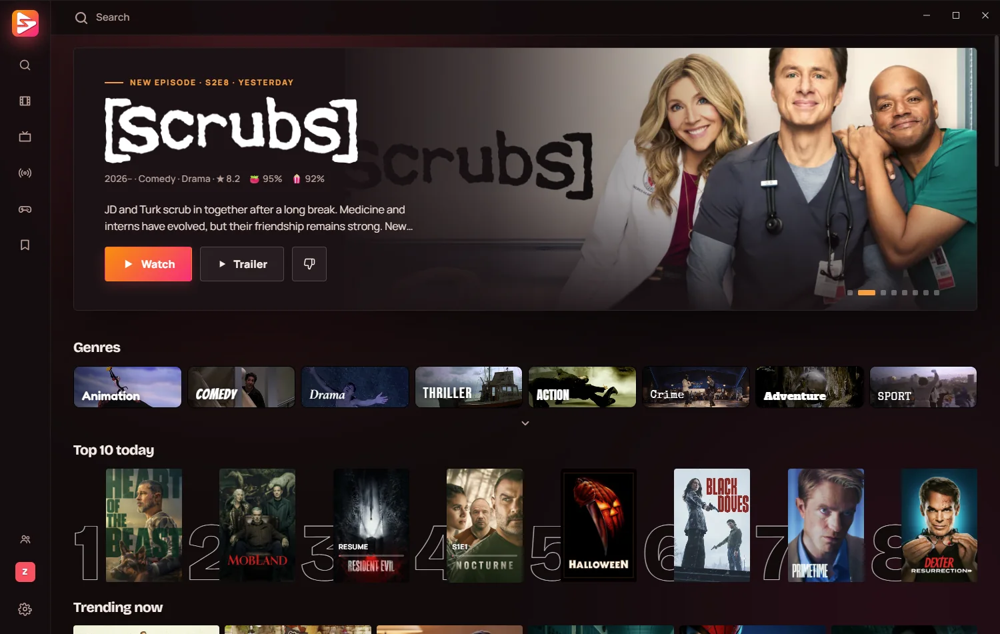
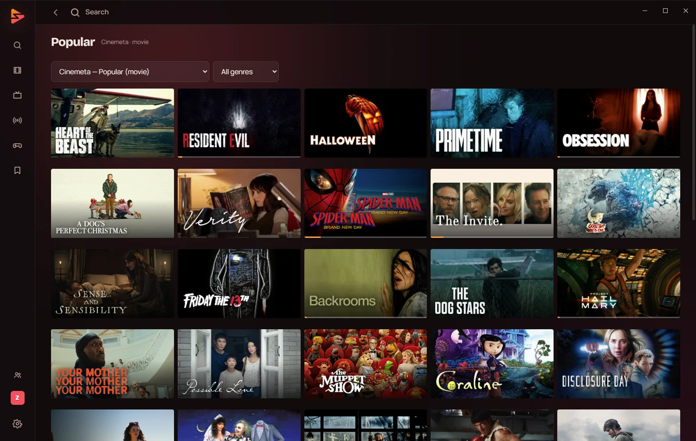
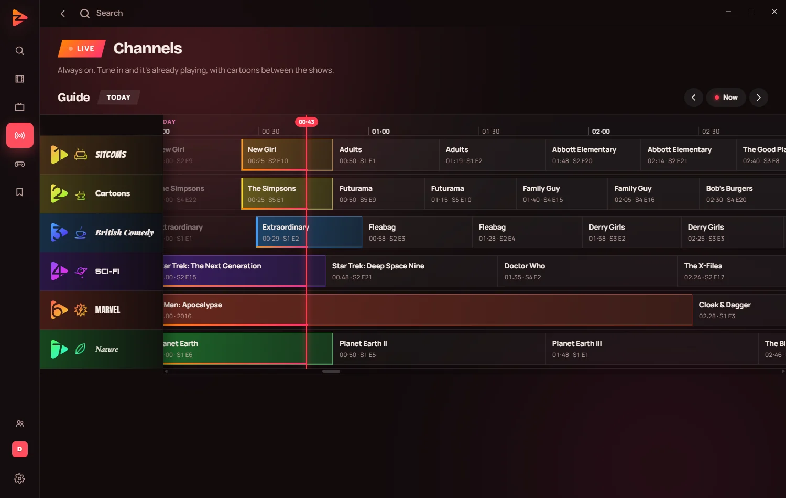
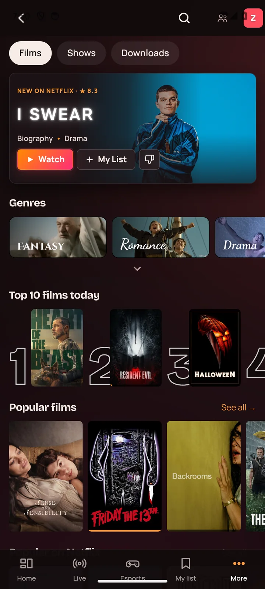
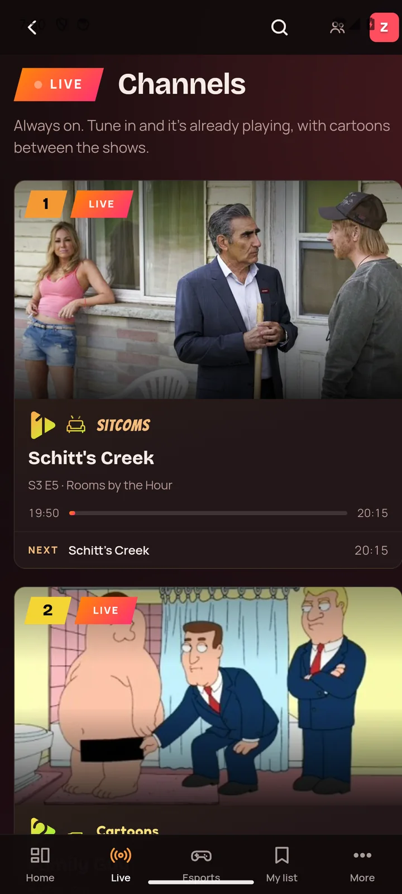
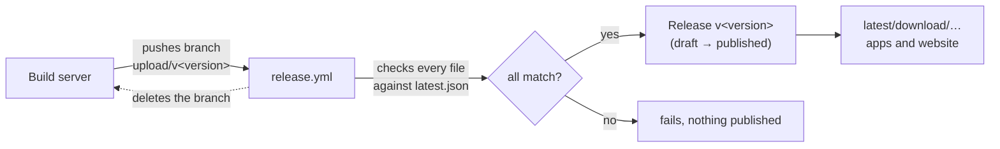

<div align="center">

<a href="https://ziggygamedev.github.io/stream-thing-releases/">
  
</a>

<br>

[](https://github.com/ZiggyGameDev/stream-thing-releases/releases/latest)
[](https://github.com/ZiggyGameDev/stream-thing-releases/releases)
[](https://github.com/ZiggyGameDev/stream-thing-releases/releases/latest)
[](https://ziggygamedev.github.io/stream-thing-releases/)

**One player for every screen.** Browse, search and play everything your addons find —<br>
on your PC, your phone and your TV, with your place in every episode following you between them.

[**Website**](https://ziggygamedev.github.io/stream-thing-releases/) ·
[**All releases**](https://github.com/ZiggyGameDev/stream-thing-releases/releases) ·
[**Install help**](#-installing)

</div>

<br>

## ⬇️ Download

Every button fetches the newest version. The addresses never change, so they're safe to bookmark or share.

<table>
<tr>
<td align="center" width="20%">
<a href="https://github.com/ZiggyGameDev/stream-thing-releases/releases/latest/download/stream-thing-windows.msi"></a><br>
<sub>Windows 10 / 11 · 64-bit<br><code>.msi</code> installer</sub>
</td>
<td align="center" width="20%">
<a href="https://github.com/ZiggyGameDev/stream-thing-releases/releases/latest/download/stream-thing-android.apk"></a><br>
<sub>Phones &amp; tablets<br><code>.apk</code></sub>
</td>
<td align="center" width="20%">
<a href="https://github.com/ZiggyGameDev/stream-thing-releases/releases/latest/download/stream-thing-android-tv.apk"></a><br>
<sub>Android TV, Google TV,<br>Chromecast · <code>.apk</code></sub>
</td>
<td align="center" width="20%">
<a href="https://github.com/ZiggyGameDev/stream-thing-releases/releases/latest/download/stream-thing-samsung-tv.wgt"></a><br>
<sub>Samsung TVs · <code>.wgt</code><br>or <a href="#-samsung-tvs-through-tizenbrew">TizenBrew</a></sub>
</td>
<td align="center" width="20%">
<a href="https://github.com/ZiggyGameDev/stream-thing-releases/releases/latest/download/stream-thing-lg-tv.ipk"></a><br>
<sub>LG TVs (webOS)<br><code>.ipk</code></sub>
</td>
</tr>
</table>

> [!NOTE]
> Once installed on Windows, Android or Android TV, the app **updates itself** — you only ever download it once.

<br>

## 👀 A look inside

<table>
<tr>
<td colspan="2"></td>
</tr>
<tr>
<td width="50%"></td>
<td width="50%"></td>
</tr>
</table>

<p align="center">
  
  &nbsp;&nbsp;
  
</p>

<br>

## ✨ What it does

The app is the browsing, the player and the plumbing between them. Everything on screen comes from the addons you install.

| | |
|---|---|
| 🗂️ **A row for every catalogue** | Home, Films and Shows lay out one row per catalogue from every addon you have. Discover browses by genre, and Search asks all of them at once. |
| 🔄 **It follows you** | Sign in with Google and your addons, your watch history and your place in every episode are there on the next screen you pick up. |
| 📺 **Live channels** | Always-on channels scheduled from the catalogue. Something is already playing when you sit down, the way television used to work. |
| ⏭️ **Skips the credits** | The app works out where an episode's credits start, and moves on to the next one for you. |
| 🎮 **Esports** | Schedules, results and the official streams, next to everything else you watch. |
| 🚀 **Keeps itself current** | Each device fetches new versions itself. Install once and you're done. |

### Bring your own addons

stream-thing speaks the [Stremio addon protocol](https://github.com/Stremio/stremio-addon-sdk/blob/master/docs/protocol.md). It comes with addons for catalogues, details and subtitles, and with **no source of streams**: what plays is up to the stream addon you add yourself.

```
1  Install the app     →  on any screen above
2  Sign in with Google →  to keep your watch history
3  Add a stream addon  →  paste its address anywhere in the app
```

<br>

## 📦 Installing

<details>
<summary><b>🪟 Windows</b></summary>

<br>

Run `stream-thing-windows.msi`. It installs for your own account — no administrator prompt — and puts stream-thing in the Start menu. mpv, which does the playing, comes with it.

</details>

<details>
<summary><b>📱 Android phones and tablets</b></summary>

<br>

stream-thing isn't on the Play Store, so Android checks with you a few times on the way. It takes about a minute, and you only do it once.

1. **Download the file.** Chrome warns about every app file: tap **Download anyway**, then **Open**.
2. **Let your browser install it.** Tap **Settings**, switch on **Allow from this source**, then go back.
3. **Install.**
4. **If Play Protect steps in,** tap **More details**, then **Install anyway**. Tapping OK cancels the install.

</details>

<details>
<summary><b>📺 Android TV and Google TV</b></summary>

<br>

A TV has no browser to download with, so a free app called **Downloader** fetches the file for you.

1. On the TV's home screen, search for **Downloader** (the orange icon, by AFTVnews) and install it.
2. Open it and type the website's address followed by `/tv`, then choose **Go**:<br>
   `ziggygamedev.github.io/stream-thing-releases/tv`
3. The first time, the TV says Downloader isn't allowed to install apps. Choose **Settings**, switch Downloader on, and press **Back**.
4. Choose **Install**, then **Open**.

Sign in from your phone with the code on screen — no typing with a remote.

</details>

<details>
<summary><b>🟦 Samsung TVs</b></summary>

<br>

The easy way is [TizenBrew](https://github.com/reisxd/TizenBrew), with nothing to sign: on the TV, add the GitHub module

```
ZiggyGameDev/stream-thing-releases
```

and open stream-thing from TizenBrew. It always opens the newest release, and the torrent engine runs beside it.

The `.wgt` above is for installing the old way, through the TV's **Developer Mode** with a Samsung certificate made for that TV.

</details>

<details>
<summary><b>⬜ LG TVs</b></summary>

<br>

An LG TV doesn't install an app from a link: turn on **Developer Mode** (LG's Developer Mode app) and install the `.ipk` with LG's webOS tools. The [website](https://ziggygamedev.github.io/stream-thing-releases/) walks through each step. This build doesn't update itself: install a new version over the old one.

</details>

<br>

## 🛠️ How a release gets here

The app's source lives in a private repo; nothing is built here. Installed copies find new versions by reading `releases/latest/download/latest.json`, which lists the newest version with the address, size and SHA-256 of every file.



> [!IMPORTANT]
> Each release also carries `stream-thing-windows.exe`, the app without its installer. It's what an installed copy on Windows downloads to update itself, so it **must stay under that name** in every release.

## 🧩 Samsung TVs, through TizenBrew

This repo is also a [TizenBrew](https://github.com/reisxd/TizenBrew) module: on the TV, add the GitHub module `ZiggyGameDev/stream-thing-releases`. `package.json` is what TizenBrew reads. It opens `tizenbrew/index.html`, which sends the TV on to the app in `samsung/`, and runs `samsung/service/tizenbrew.js` beside it (the torrent engine).

> [!WARNING]
> `samsung/` is the Samsung build unpacked: the release workflow puts each release's there, and sets the version in `package.json`, before it makes the release. **Don't edit it by hand.**

## 🌐 The website

The files at the top level — `index.html`, `styles.css`, `main.js`, `assets/`, `tv/`, and `samsung/` for TizenBrew — are the site, served by GitHub Pages from `main`. There's no build step: edit and push. The download buttons link to the `latest` addresses above, so the site never needs touching for a new version.

<br>

<div align="center">
<sub>Made by <a href="https://github.com/ZiggyGameDev">ZiggyGameDev</a> · Not affiliated with Stremio</sub>
</div>
